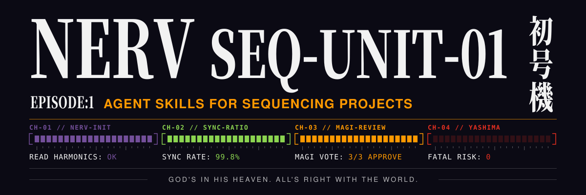
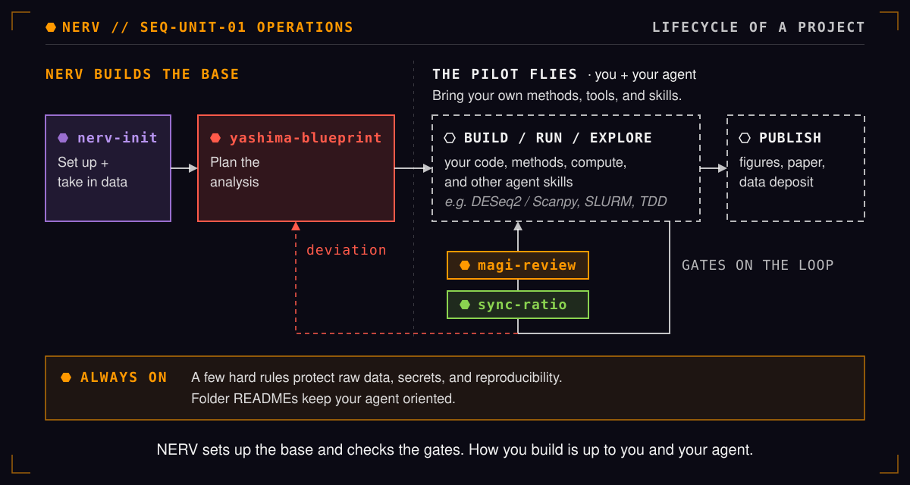

<div align="center">



[](skills/nerv-init/)
[](skills/sync-ratio/)
[](skills/magi-review/)
[](skills/yashima-blueprint/)

**[Quick start](#quick-start) · [The skills](#the-skills) · [Install](#install) · [Repository layout](#repository-layout) · [Requirements](#requirements) · [Raw data protection](#raw-data-protection) · [License](#license)**

<sub>Unofficial fan homage. Not affiliated with or endorsed by khara, Inc. The MIT license covers this code, not Evangelion names or marks.</sub>

</div>

# NERV skills for sequencing projects

Agent skills that set up and look after bioinformatics sequencing projects (bulk RNA-seq, scRNA-seq, and others) with AI coding agents. They give the agent layered documentation: a short `AGENTS.md` pointing to per-folder READMEs. A hard rule and read-only deliveries protect raw data, an on-demand check keeps those READMEs current, and a review process is tuned to bioinformatics risks such as reproducibility, provenance, and statistical validity.

Works with **Claude Code** and **Codex**.

> **NERV briefing.** NERV builds the base, and every project it sets up is a Unit. The MAGI vote on risky changes. The AT Field (each read-only delivery) stands around `data/raw/`. The sync ratio shows which READMEs have fallen behind their folders. And, as in Operation Yashima, where there was only one shot, everything that could make an analysis miss is removed before any result exists.



## Quick start

1. In a new project folder, empty or already holding your raw data (anywhere except a `data/` folder, which counts as a conflict), install the skills:
   ```bash
   npx skills add tingtmu/Seq-Unit-01 -a claude-code -a codex --skill nerv-init sync-ratio magi-review yashima-blueprint --copy -y
   ```
   To install once for all your projects instead, use `-g` and drop `--copy`:
   ```bash
   npx skills add tingtmu/Seq-Unit-01 -g -a claude-code -a codex --skill nerv-init sync-ratio magi-review yashima-blueprint -y
   ```
2. Start your agent in that folder. In Claude Code, run `/nerv-init`; in Codex, run `$nerv-init`. The agent looks at the folder first and proposes what the files show (such as the assay, and reads or precomputed counts), then asks the rest of the short interview (assay, workflow engine, language, compute, data sensitivity, project question). After your yes it generates the project, takes in the raw data it found (or asks you for it), records each file's provenance, and makes each delivery read-only.
3. Day to day, ask for what you need:
   - "Plan the analysis" → `yashima-blueprint`
   - "Review my change" → `magi-review`
   - "Are the folder READMEs up to date?" → `sync-ratio`

[Install](#install) explains the per-project and global options and gives a fallback without Node.

## The skills

| Skill | What it does | The name |
|-------|--------------|----------|
| `nerv-init` | **Looks at the folder first**, proposes the answers its files settle, and **interviews you** for the rest (assay, workflow engine, language, compute, data sensitivity, the project question or `TBD`), then **generates the project**: **folder skeleton**, **`AGENTS.md` + `CLAUDE.md`**, a **4-section README per folder**, a **pinned conda environment** (`envs/workflow.yaml`) and **one smoke test per language** so the Run and Test commands pass on day one, `.gitignore`, `.gitattributes` (LF line endings), and `git init`. It then **takes in the raw data** it found, or asks you for it: each delivery goes in `data/raw/<delivery>/` as received, with provider checksums verified, **its provenance recorded** in `data/README.md`, the delivery **made read-only**, and the sample sheet filled from the sample metadata. If no git identity is set, it asks for your name and email and **saves them for this project only** (never globally). It then **makes the first commit itself** (and asks before including files it didn't generate), and ends by asking what you want to compare. | NERV is the organization that builds and runs the base everything launches from. |
| `sync-ratio` | **Lists folders that changed significantly without a README update** and **drafts the updates** (only "Current state" and "Last major change"). | The sync ratio measures how well pilot and Eva move as one; here, how well a README matches its folder. |
| `magi-review` | **Risk-scaled review.** **TRIVIAL** changes are skipped. **STANDARD** changes get one reviewer applying three lenses. **CRITICAL** changes get **three independent seats that vote**: MELCHIOR-1 (science), BALTHASAR-2 (safety), CASPER-3 (craft). A **2/3 majority wins**; **BALTHASAR can veto** on hard-rule violations. | The MAGI are three supercomputers that decide by majority vote. |
| `yashima-blueprint` | **Plans an analysis before any results exist.** It **reads the project first**, **ranks the fatal risks** (those no later code change can fix, such as batch confounded with condition) and **names the false result each would produce**, then, once you agree, **commits the analysis plan and its thresholds**. The plan carries its own confirmatory scope and an append-only Deviations section. It hands off to boundary tests and `magi-review`; **it writes no code**. | Operation Yashima had one shot, so everything that could make it miss was removed before firing. |

Generated projects keep one testing cue in `tests/README.md`: use tiny synthetic inputs with explicit expected outputs, including negative or boundary cases that distinguish the intended rule from a plausible wrong implementation. The skeleton no longer prescribes test-first order; existing review guidance remains. This applies to newly generated projects. The [saved cue benchmark](bench/README.md#historical-baseline-2026-11-03) measured the original three-cue bundle; the replacement has not been benchmarked.

## Install

**Per project (recommended).** Run in the project directory:

```bash
npx skills add tingtmu/Seq-Unit-01 -a claude-code -a codex --skill nerv-init sync-ratio magi-review yashima-blueprint --copy -y
```

This puts the skills in `.claude/skills/` (Claude Code) and `.agents/skills/` (Codex). Then run `/nerv-init` in Claude Code or `$nerv-init` in Codex.
- Commit `.claude/skills/`, `.agents/skills/`, and `skills-lock.json`, so every clone has the same skill versions. `--copy` makes them real files; symlinks would break when the project is cloned elsewhere.
- Using only one agent? Drop the other `-a`.
- If the agent doesn't list the new skills yet, start a new session.

**Global (all your projects).** Add `-g` and drop `--copy`:

```bash
npx skills add tingtmu/Seq-Unit-01 -g -a claude-code -a codex --skill nerv-init sync-ratio magi-review yashima-blueprint -y
```

This puts the skills in `~/.claude/skills/` and `~/.agents/skills/`, so they are available in every project without reinstalling. They are not part of any project's repo, so a clone on another machine needs its own install. The files that `nerv-init` generates, including the doc-sync report in `.nerv/scripts/`, still live in each project.

Install paths and flags checked against the `vercel-labs/skills` docs on 2026-11-01 (per-project paths and `--copy` on 2026-10-29).

### Fallback without Node

```bash
git clone --depth 1 https://github.com/tingtmu/Seq-Unit-01 /tmp/nerv-skills
mkdir -p .claude/skills .agents/skills
cp -r /tmp/nerv-skills/skills/* .claude/skills/
cp -r /tmp/nerv-skills/skills/* .agents/skills/
rm -rf /tmp/nerv-skills
```

PowerShell:

```powershell
git clone --depth 1 https://github.com/tingtmu/Seq-Unit-01 $env:TEMP\nerv-skills
New-Item -ItemType Directory -Force .claude\skills, .agents\skills | Out-Null
Copy-Item -Recurse $env:TEMP\nerv-skills\skills\* .claude\skills\
Copy-Item -Recurse $env:TEMP\nerv-skills\skills\* .agents\skills\
Remove-Item -Recurse -Force $env:TEMP\nerv-skills
```

Each skill folder is self-contained, so you can copy just one, for example only `nerv-init`.

## Repository layout

```
skills/
  nerv-init/     SKILL.md, references/interview.md, scripts/{scaffold.py,sync_ratio.py},
                 templates/{base,addons,engines,languages}/
  sync-ratio/    SKILL.md
  magi-review/   SKILL.md, references/{levels,seat-briefs,receiving-feedback}.md
  yashima-blueprint/ SKILL.md
bench/           dev tooling, not shipped: an A/B cue benchmark (tasks, hidden tests, mutants,
                 runner, scorer, summary); historical results cover the original test-first cues;
                 see bench/README.md
tests/           pytest for the scaffold, the doc-sync report, templates, skill docs, and bench/
assets/          README art: banner.svg and lifecycle.svg, generated by make_banner.py and
                 make_lifecycle.py from the shared colours in palette.py
```

Run the tests with `python -m pytest`; the only requirement is pytest.

## Requirements

- Python 3 (standard library) for the scaffold script
- git
- Node, only for `npx skills`

## Raw data protection

`nerv-init` installs no agent hooks. Raw data is protected in three ways:

- **A hard rule.** The generated `AGENTS.md` says never to delete, move, overwrite, or edit files in `data/raw/`, that deliveries there are read-only, and that fixes are workflow steps writing to `data/processed/`.
- **Read-only deliveries.** Once a delivery's provenance is recorded, `nerv-init` makes it read-only at the OS level (`chmod -R a-w`, or `attrib +R /S` on Windows). `data/raw/` itself stays writable, so the next delivery goes in a new folder without changing permissions. The generated `data/README.md` has the commands, including how to make a delivery writable again to replace a broken file.
- **Review.** `magi-review` checks every change for code that writes, moves, or deletes under `data/raw/`, including through scripts and workflow outputs, and a hard-rule violation is a veto.

Limit: on macOS and Linux, a read-only delivery's files cannot be deleted or overwritten by any tool until someone restores write permission. On Windows, the read-only attribute blocks overwrites, Python deletes, and a plain PowerShell `Remove-Item`, but **Git Bash `rm` and PowerShell `Remove-Item -Force` still delete read-only files** (checked on 2026-11-02). There, the hard rule is the protection.

Projects created by earlier versions have a raw-data hook, which keeps working. To remove it, delete `.nerv/hooks/` and `.nerv/raw-snapshot.json`, remove only the entries that run `.nerv/hooks/raw_guard.py` from `.claude/settings.json` and `.codex/hooks.json` (delete a file only if nothing else is left in it, since it may hold your own settings), and drop the `.nerv/*raw-snapshot*` line from `.gitignore`.

## License

MIT
